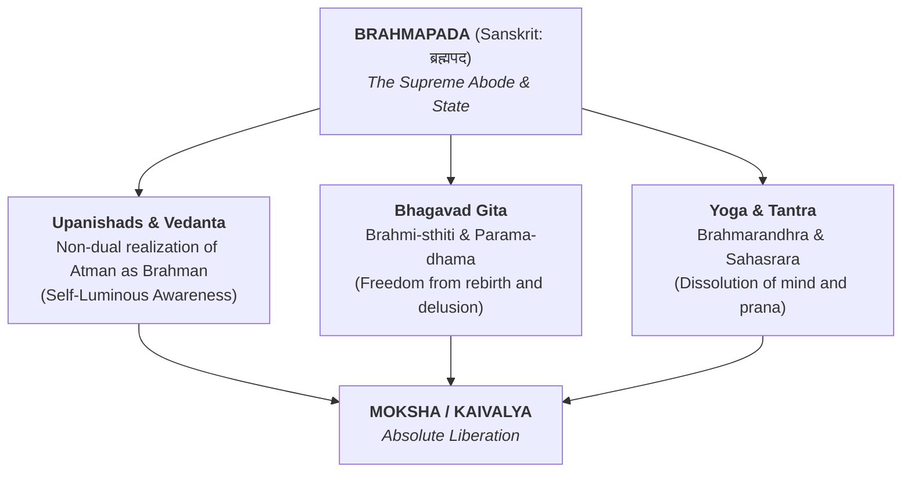

# Brahmapada

## The Supreme Abode and the Ultimate State of Consciousness

In Indian philosophical, scriptural, and esoteric traditions, **Brahmapada** (ब्रह्मपद) is a foundational compound term that signifies both the _ultimate metaphysical destination_ and the _highest state of unconditioned awareness_.

Composed of two root Sanskrit words—**Brahma** (ब्रह्म, _the Supreme Reality, Infinite Consciousness, or Absolute Existence_) and **Pada** (पद, _footstep, abode, state, status, or goal_)—Brahmapada literally translates to **"the Abode of Brahman"** or **"the Footing in the Absolute."**

Across the _Upanishads_, the _Bhagavad Gita_, the _Puranas_, and classical Yogic literature, Brahmapada represents the final frontier of spiritual evolution: the complete cessation of cycle of birth and rebirth (_Samsara_) and the total immersion of individual self-awareness into Pure Being.

## Metaphysical and Etymological Meanings

To fully grasp the scope of _Brahmapada_, classical commentators analyze its primary connotations:

### 1. The Supreme Abode (_Parama-Dhāma_)

In cosmographical and Puranic literature, Brahmapada is used locatively to denote **Brahmaloka**—the highest realm within the cosmic hierarchy, presided over by Brahma the Creator. However, in higher non-dualistic (_Advaita_) contexts, it transcends any physical or spatial realm, denoting instead the uncreated, omnipresent realm of pure spirit that exists beyond the physical and subtle universes.

### 2. The Absolute State of Consciousness (_Mukti_ or _Kaivalya_)

In Upanishadic psychology, "Pada" refers to a state of being (_Avasthā_). Thus, Brahmapada is not a location one physically travels to, but a **transformation of perception**. It is synonymous with:

- **Turiya:** The "Fourth" state of consciousness beyond waking, dreaming, and deep sleep.
- **Moksha / Mukti:** Complete liberation from causal karma and egoic identity.
- **Brahmi-Sthiti:** The steadfast establishment in Brahman described in the _Bhagavad Gita_ (Chapter 2.72).

### 3. The "Footprint" or Path of Realization

In Vedantic hermeneutics, _Pada_ also carries the nuance of a trail or trace left behind. Here, Brahmapada implies the direct path laid down by self-realized sages—the intellectual and spiritual methodology (_Jnana_, _Vairagya_, _Viveka_) that leads directly to the discovery of Brahman within one's own heart.  

## Scriptural References and Interpretations

### The Upanishads and Vedanta

In texts like the _Katha Upanishad_ and _Mundaka Upanishad_, the seeker's journey is framed as traveling from limited sensory engagement to the ultimate foothold (_Parama-pada_ or _Brahmapada_). The famous verse from the _Katha Upanishad_ (I.3.9) states:

> _"He who has understanding for his driver and holds the reins of the mind firmly, reaches the end of the journey—that supreme abode of the All-Pervading (_Tad Vishnoh Paramam Padam_)."_

In Shankara's commentary on Vedanta, attaining Brahmapada is clarified as a non-event in terms of physical motion: because Brahman is all-pervading, "reaching" Brahmapada simply means dispelling the ignorance (_Avidya_) that made one feel separate from it in the first place.

### The Bhagavad Gita

While the _Gita_ frequently uses terms like _Brahmi-Sthiti_ (standing in Brahman) and _Paramam Dhāma_ (Supreme Abode), commentators explicitly link these to _Brahmapada_. In Chapter 18, Verse 53–55, Krishna outlines the psychological prerequisites for attaining Brahmapada:

1. Abandoning egoism (_Ahamkara_), violence, pride, desire, and anger.
2. Cultivating solitude, light eating, and control over speech, body, and mind.
3. Constantly absorbing the intellect in meditation and dispassion (_Vairagya_).

Upon fulfilling these, the seeker becomes fit for becoming Brahman (_Brahma-bhūyāya kalpate_) and abides in Brahmapada.

### Yoga and Esoteric Anatomy (Tantra)

In the subtle energy systems of Hatha Yoga and Tantra, Brahmapada is structurally mapped to the highest center of subtle anatomy:

- **Brahmarandhra:** The "aperture of Brahma" located at the crown of the head.
- **Sahasrāra Chakra:** The thousand-petaled lotus where _Kundalini Shakti_ (coiled evolutionary energy) unites with _Shiva_ (Unmanifest Consciousness).

When the practitioner's breath (_Prana_) and attention enter the central channel (_Sushumna Nadi_) and ascend through the subtle centers, their awareness dissolves into the crown. This dissolution of mind (_Manonasa_) into the crown center is described as reaching _Brahmapada_ in Yogic manuals like the _Hatha Yoga Pradipika_.

## Brahmapada vs. Other States of Existence

To distinguish Brahmapada from lesser spiritual achievements, classical scholars contrast it with lower realms and temporary states:

|**Dimension**|**Devalloka / Svarga (Lower Heavens)**|**Brahmaloka (Phenomenal Creator Realm)**|**Brahmapada (Ultimate Realization)**|
|---|---|---|---|
|**Nature**|Temporal / Merit-based|Highest created world|Uncreated / Non-contingent|
|**Governing Force**|Good Karma (_Punya_)|High spiritual practice (_Upasana_)|Self-Knowledge (_Jnana_) / Total Grace|
|**Permanence**|Temporary; leads back to rebirth|Lasts until cosmic dissolution (_Pralaya_)|**Eternal; no return to Samsara**|
|**State of Self**|Egoic enjoyment of refined pleasures|Refined subtle self near the Creator|**Dissolution of ego into Absolute Consciousness**|

## Summary

**Brahmapada** represents the synthesis of Indian spiritual aspiration. It bridges the spatial imagery of ancient cosmology with the non-dual psychospiritual insight of Vedanta and Yoga. Whether understood as the ultimate transcendent realm or as the immediate, self-luminous reality of one's own innermost Self (_Atman_), Brahmapada stands as the definitive term for total liberation, peace, and unshakeable fulfillment.