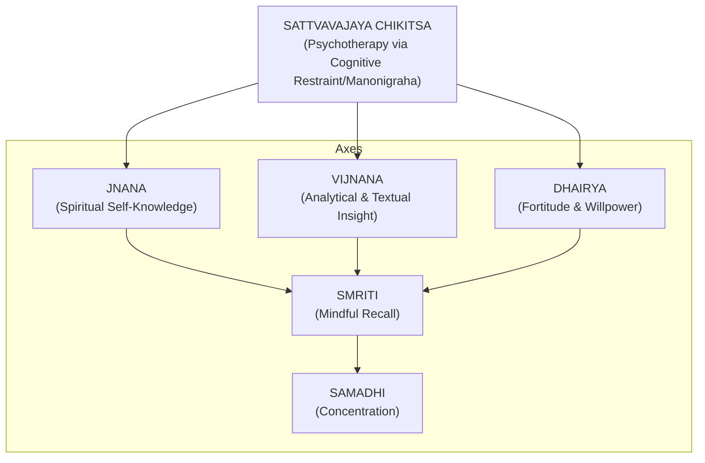
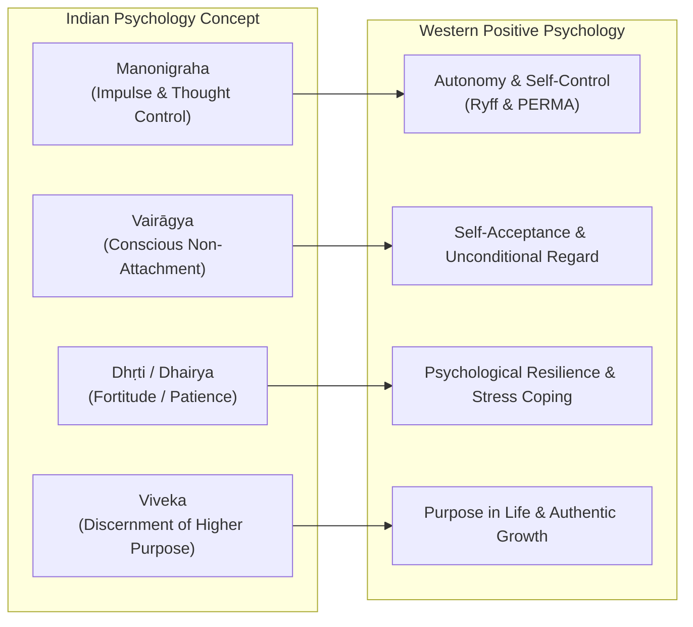

# Manonigraha

### **1. Introduction and Etymological Foundations**

In ancient Indian psychology and contemplative traditions, **Manonigraha (मनोनिग्रह)** stands as the foundational pillar of mental resilience, emotional regulation, and spiritual liberation. Derived from the Sanskrit roots _**manaḥ**_ (the sensory processing mind or thought) and _**nigraha**_ (restraint, subjugation, or structured control), the term literally translates to the **mastery or governance of the mind**.

Far from denoting harsh emotional suppression, forced ignorance, or the mechanical stifling of thoughts, _Manonigraha_ represents the **deft management, structural alignment, and intentional direction of cognitive energy**. In the holistic worldview of Indian thought, the human apparatus operates across distinct levels of personhood: the physical body (_sthūla śarīra_), the subtle body (_sūkṣma śarīra_, comprising _manas_ and the analytical intellect _buddhi_), and the transcendent Self (_Ātman_).

The _manas_ is defined as an internal instrument that is **dual-acting (_ubhayātmaka_)**—executing both sensory perception (_jñānendriya_) and physical action (_karmendriya_)—and characterized by **atomicity (_aṇutva_) and unity (_ekattva_)**. Because of its atomic nature, the mind can dock onto only one sensory register at any given fraction of time. However, its hyper-rapid movement across sensory portals creates the illusion of simultaneous multi-channel processing. Unregulated, this rapid oscillation entangles consciousness with fleeting sensory objects, triggering psychological distress. _Manonigraha_ is the discipline that halts this chaotic drift, transforming the mind from a source of bondage into a powerful instrument of self-realization (_Mokṣa_) and human flourishing.

---

### **2. Philosophical and Textual Foundations**

The philosophy of _Manonigraha_ spans the major schools of Indian thought, each offering distinct metaphors, structural frameworks, and meditative practices:

#### **The Katha Upanishad: The Chariot Metaphor and Internal Gradation**

The _Katha Upanishad_ presents one of the most celebrated allegories of cognitive architecture. The individual human being is likened to a chariot complex:

- The **Ātman (Self)** is the master/rider sitting within the chariot.
- The **Body** is the physical chariot itself.
- The **Buddhi (Intellect)** is the charioteer holding the reins.
- The **Manas (Mind)** functions as the reins.
- The **Indriyas (Senses)** are the horses pulling the chariot along the roads of sensory objects.

When the charioteer (_Buddhi_) lacks discrimination (_avijñānavān_) and the reins (_Manas_) remain unrestrained, the senses act like **wicked, wild horses (_duṣṭāśvāḥ_)**, dragging the chariot off course into the cyclical misery of _saṁsāra_. Conversely, when the intellect is vigilant and the mind's reins are firmly held, the senses become like well-trained horses, guiding the seeker safely to the supreme goal (_viṣṇoḥ paramaṁ padam_).

The _Katha Upanishad_ outlines a precise **hierarchy of cognitive progression** for self-mastery: *beyond the physical senses are their subtle objects, beyond objects is the mind (_manas_), beyond the mind is the intellect (_buddhi_), beyond the intellect is the Cosmic Mind (_Mahat_), and beyond all lies the transcendent Pure Consciousness (_Puruṣa_). Self-control demands leveraging these superior levels of consciousness rather than relying on lower sensory willpower alone. Furthermore, it requires developing **discrimination (_viveka_)** to choose _**Śreyas**_ (the ultimate, permanent spiritual good) over _**Preyas**_ (the immediate, short-term pleasant temptation).

#### **Patanjali’s Yoga Sutras: Stilling Cognitive Fluctuations**

Patanjali formalizes _Manonigraha_ as the very definition of Yoga: _**"yogaś citta-vṛtti-nirodhaḥ"**_ **(PYS 1.2)—the intentional inhibition or stilling of the turbulent wave-patterns (_vṛttis_) of the mind-stuff (_citta_)**. Left unmanaged, subconscious impressions (_saṁskāras_) constantly propel desires into conscious awareness, causing the observer to falsely identify with mental turbulence.

Patanjali prescribes a dual method for achieving _nirodha_:

1. **_Abhyāsa_ (Sustained Practice):** The continuous, dedicated effort to anchor attention in stillness.
2. **_Vairāgya_ (Detachment/Non-attachment):** The conscious dispassion toward sensory appetites and transient rewards.

When unwholesome or destructive thoughts arise, Patanjali advises **Pratipakṣa Bhāvana**—the active cognitive restructuring technique of intentionally cultivating opposing, wholesome thoughts to neutralize emotional volatility.

#### **The Bhagavad Gita and Karma Yoga: Unselfish Action and Equanimity**

In the _Bhagavad Gita_, Lord Krishna highlights the self-regulatory imperative: _"One must elevate oneself by the mind, not degrade oneself; for the mind is the friend of the conditioned soul, and his enemy as well"_ (BG 6.5).

In the context of _Karma Yoga_, _Manonigraha_ is operationalized as **Atma-Saṁyama Yoga**—an internal sacrifice (_yajña_) where sensory functions and vital energies are offered into the fire of self-restraint kindled by knowledge. Rather than abandoning work, the practitioner practices **Niṣkāma Karma** (performing duty without selfish attachment to outcomes). By renouncing attachment to success and failure (_phala-āśā-tyāga_), the individual cultivates **mental equanimity (_samatvam_)**, ensuring that external work does not create psychological friction or emotional debt.

#### **Advaita Vedānta: From Deliberate Practice to Spontaneous Ornament**

In _Advaita Vedānta_ and Gaudapada's _Maṇḍūkya Kārikā_, a crucial distinction is made between the aspirant (_Sādhaka_) and the liberated sage (_Jñānī_):

- For the **Sādhaka**, mental discipline (**Śama** / _Manonigraha_) and sensory restraint (**Dama**) are deliberate, effortful practices required to purify the internal instrument (_antaḥkaraṇa_).
- For the **Jñānī**, who has realized their true identity as the non-dual witness consciousness (**Sākṣī** or _Turīya_), _Manonigraha_, _Śama_, and _Dama_ cease to be deliberate exercises. They become **spontaneous, effortlessly natural attributes (_akṛtaka_ or _svābhāvika_)**—functioning as an intrinsic ornament (_bhūṣaṇa_) of enlightenment.

The _Jñānī_ understands that while mental fluctuations belong to the empirical realm (_vyavahāra_), the underlying _Ātman_ remains eternally peaceful (_Paramārtha Satyam_) and untouched by mental disturbances.

---

### **3. Ayurvedic Sattvavajaya Chikitsa: Clinical Psychology of Mind Restraint**

In Ayurvedic medicine, particularly within the classical treatise of Charaka Samhita, _Manonigraha_ forms the clinical cornerstone of **Sattvavajaya Chikitsa (Ayurvedic Psychotherapy)**. Defined formally as ***"Sattvāvajayaḥ punar ahitebhyo 'rthebhyo manonigrahaḥ"***, it is the non-pharmacological clinical mechanism of **restraining the mind from unwholesome sensory inputs (_ahita-artha_) and toxic behavioral loops**.

#### **The Pathodynamics of Mental Degradation: Prajñāparādha**

Ayurveda attributes psychosomatic ailments (_ādhijāvyaḍhi_) to **Prajñāparādha ("crimes against wisdom" or intellectual blasphemy)**. This occurs when the cognitive matrix undergoes a threefold failure:

1. **_Dhī-Vibhramṣa_ (Corrupted Intellect):** The inability to distinguish between wholesome (_hita_) and unwholesome (_ahita_) choices.
2. **_Dhṛti-Vibhramṣa_ (Corrupted Willpower):** The complete breakdown of self-regulatory strength, where an individual knows a habit is harmful (e.g., addiction, toxic reactivity) but lacks the fortitude to resist the sensory pull.
3. **_Smṛti-Vibhramṣa_ (Corrupted Memory):** The clouding of past experiential lessons, repeating destructive behavioral cycles.

#### **The Five Clinical Axes of Sattvavajaya**

To correct _Prajñāparādha_ and suppress internal toxic impulses (**Dhāraṇīya Vegas** such as greed, wrath, hatred, and envy), Ayurveda outlines five psychotherapeutic vectors:

1. **_Jñāna_ (Spiritual Self-Realization):** Cultivating _Atma-Jñāna_ to dissolve false ego-identifications (_ahaṁkāra_) and excessive worldly attachments (_upādhā_).
2. **_Vijñāna_ (Analytical Understanding):** Using scriptural knowledge and cognitive analysis to comprehend cause-and-effect patterns in behavior.
3. **_Dhairyai_ (Fortitude & Willpower):** Strengthening emotional patience and regulatory capacity to delay immediate gratification and endure life's challenges.
4. **_Smṛti_ (Mindful Recall):** Calibrating memory to re-anchor the individual in their true identity and past wisdom.
5. **_Samādhi_ (Tranquil Concentration):** Diverting the senses inward into the mind to achieve complete cessation of wavering mental states.

#### **Integration with Chittaprasadana and Behavioral Rejuvenation**

Ayurvedic psychotherapy directly integrates Patanjali’s social-emotional matrix (**Chittaprasadana**) as a behavioral cognitive restructuring protocol:

- **_Maitrī_ (Universal Friendliness):** Cultivated toward happy individuals (_sukha_) to down-regulate envy and social comparison.
- **_Karuṇā_ (Compassion):** Expressed toward those in distress (_duḥkha_) to neutralize self-centeredness and harsh judgment.
- **_Muditā_ (Sympathetic Joy):** Practiced toward the virtuous (_puṇya_) to convert competition into inspiration.
- **_Upekṣā_ (Equanimity):** Deployed as a protective shield toward the non-virtuous (_apuṇya_) to prevent external systemic toxicity from penetrating the mind.

Furthermore, Ayurveda embeds _Manonigraha_ into daily life through **Sadvṛtta** (codes of noble conduct) and **Āchāra Rasāyana** (behavioral rejuvenators). Practicing calm speech, truthfulness, cleanliness, and emotional moderation nourishes bodily tissues (_dhātus_) and vital essence (_ojas_), providing the exact cellular and mental rejuvenation of expensive therapies without consuming a single herb.

#### **Prakṛti-Specific Tailoring**

Ayurvedic psychology recognizes that mental breakdown varies according to an individual's **Deha-Mānasa Prakṛti (somatic-psychic constitution)**:

- **Vāta-Dominant Archetypes:** Express cognitive disruption as fragmentation, anxiety, erratic focus, and physical unsteadiness. _Sattvavajaya_ intervention requires reassuring counseling (**Āśvāsana**) and grounding stability.
- **Pitta-Dominant Archetypes:** Manifest distress through anger (_krodha_), irritability, perfectionism, and acute judgment. Therapy demands cooling compassion (**Karuṇā**), forgiveness, and internal discernment (_viveka_).
- **Kapha-Dominant Archetypes:** Express degradation through structural inertia (**Styāna**), lethargy (**Ālasya**), and stubborn attachment. Therapy requires psychological stimulation, behavioral awakening, and active renunciation (**Tyāga**).

---

### **4. Modern Psychological & Neuroscientific Dimensions**

Contemporary psychological research increasingly validates _Manonigraha_ as an indigenous framework for **eudaimonic well-being**—the Aristotelian and positive psychological ideal of human flourishing achieved through virtue, self-mastery, and purposeful living, as opposed to mere hedonic pleasure-seeking.

#### **Cross-Mapping to Modern Positive Psychology**

_Manonigraha_ seamlessly maps onto major Western models of flourishing:

- **Ryff’s Six-Factor Model:** _Manonigraha_ directly reinforces **Autonomy** (mastering internal impulses rather than being driven by external stimuli), **Environmental Mastery** (regulating emotional reactions to hardship), and **Personal Growth**.
- **Seligman’s PERMA Model:** Self-discipline and mindful detachment enhance **Accomplishment**, **Meaning/Purpose**, and **Positive Relationships** by eliminating reactive conflict.

#### **Neuroscientific Correlates**

Modern neuroimaging (fMRI and EEG) and neuroendocrine studies confirm the physiological mechanism of ancient mind-training practices:

- **Brain Structure:** Sustained meditative control increases **cortical thickness in the prefrontal cortex** (the anatomical locus of higher cognition, executive functioning, and _buddhi_).
- **Emotional Regulation:** Practice **down-regulates reactivity in the amygdala** (the brain's fear and emotional response center), directly facilitating better _Manonigraha_ and reduced anxiety.
- **Neurochemical Balance:** Regulates stress hormones (**cortisol and adrenaline**) while elevating neurotransmitters like **serotonin and dopamine**, mirroring the cultivation of _Sattva Guna_ (mental clarity and contentment).

---

### **5. Practical Tools and Everyday Discipline**

To translate _Manonigraha_ from abstract philosophy into daily life, traditional masters like **Swami Sivananda** formulated concrete, structured habits that replace erratic willpower with robust behavioral architecture:

1. **Fixed Wake-Up Time (_Brahmamuhūrta_):** Rising at a fixed early hour (ideally between 3:30 and 5:30 a.m.) anchors daily discipline before the mind accumulates daytime friction.
2. **Concretization of _Saṅkalpa_:** Turning abstract moral intentions into specific physical acts with a fixed time, place, and duration (e.g., replacing _"I will be disciplined"_ with _"I will sit for 15 minutes of prāṇāyāma every morning at 6:00 a.m."_).
3. **Body as Infrastructure:** Treating physical health as the physical instrument of mental mastery—practicing daily _āsanas_, post-meal walks, and light dietary intake (_Niyatāhāra_) to prevent _Tamas_ (lethargy) from clouding concentration.
4. **The Self-Auditing Diary:** Keeping a daily written log to score oneself objectively across key behavioral metrics (e.g., patience, speech control, regularity) every evening, ensuring hard personal accountability.
5. **Deliberate Rest as _Sādhanā_:** Scheduling fixed, intentional periods of evening rest to replenish depleted willpower, preventing the mind from becoming chronically reactive.
6. **The Five Tools of Thought Regulation:** Applying the structured Ayurvedic sequence for thought management—**Chintya** (thought filtering), **Vichārya** (logical consideration), **Ūhya** (reasoning), **Dhyeya** (focused reflection), and **Saṅkalpa** (firm determination).

---

### **Conclusion**

_Manonigraha_ is neither a relic of ancient asceticism nor a simple relaxation technique; it is a **comprehensive, time-tested science of cognitive self-mastery**. By integrating the philosophical depth of the _Upanishads_, the meditative precision of Patanjali’s _Yoga Sutras_, the unselfish action of the _Bhagavad Gita_, and the clinical rigor of Ayurvedic _Sattvavajaya Chikitsa_, _Manonigraha_ provides a holistic paradigm for mental health. It offers contemporary society a transformative path out of cognitive instability (_Chitta-Vikṣepa_), guiding the human mind away from reactive impulse and toward lasting serenity, resilience, and eudaimonic flourishing.

