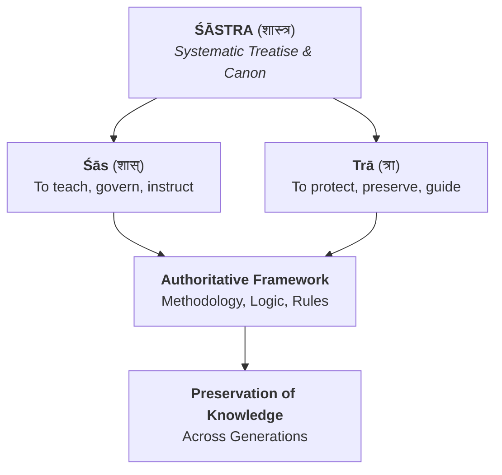

# Śāstra

## The Systematized Canon of Knowledge and Authority in Indian Thought

In the intellectual, spiritual, and social traditions of India, **Śāstra** (Sanskrit: शास्त्र, _Śāstra_) represents the apex of formal knowledge organization. Beyond merely meaning "book" or "text," a _Śāstra_ is a specialized treatise, authoritative manual, or scientific codification designed to provide rigorous instruction on a specific field of study.

From grammar, ethics, and governance to architecture, medicine, and spiritual liberation, the _Śāstra_ tradition transformed diverse human pursuits into formal, empirical disciplines (_Vidyās_).

## Etymology and Definition

The word _Śāstra_ is derived from two distinct Sanskrit verbal roots that capture its dual function as both a **guide** and an **authority**:

- **Śās (शास्):** Meaning "to instruct," "to teach," "to govern," or "to discipline."
- **Trā (त्रा):** A instrumental suffix meaning "that which protects" or "that which serves as a tool."

Thus, etymologically, a _Śāstra_ is **"that which protects by offering systematic instruction and discipline."** It provides the structural boundary within which a practice can be understood, mastered, and preserved across generations without corrupting its underlying principles.

## The Fourfold Taxonomy of Human Life (_Puruṣārtha_) & Śāstric Literature

Classical Indian intellectual life organized its major _Śāstras_ around the four fundamental goals of human existence (_Puruṣārthas_):

|**Puruṣārtha (Goal)**|**Associated Śāstra Discipline**|**Core Focus & Exemplary Texts**|
|---|---|---|
|**Dharma** (_Righteousness & Duty_)|**Dharmaśāstra**|Moral order, jurisprudence, social ethics, ritual duties (_Manusmṛti_, _Yājñavalkya Smṛti_).|
|**Artha** (_Wealth & Governance_)|**Arthaśāstra**|Statecraft, economics, diplomacy, political administration (_Kautilya’s Arthaśāstra_).|
|**Kāma** (_Aesthetics & Pleasure_)|**Kāmaśāstra**|Sensual arts, emotional well-being, aesthetics, intimate human relationships (_Vātsyāyana’s Kāmasūtra_).|
|**Mokṣa** (_Liberation_)|**Mokṣaśāstra**|Metaphysics, cognitive control, spiritual release (_Yoga Sūtras_, _Brahma Sūtras_, _Upanishads_).|

Beyond the four primary goals, the _Śāstra_ framework extended to every technical and creative enterprise:
- **Viyākaraṇa-śāstra:** Linguistics and grammar (e.g., Pāṇini’s _Aṣṭādhyāyī_).
- **Nāṭya-śāstra:** Dramaturgy, dance, and music performance (e.g., Bharata Muni’s _Nāṭyaśāstra_).
- **Vāstu-śāstra:** Architecture, spatial alignment, and urban design.
- **Cikitsā-śāstra / Āyurveda:** Medicine, pharmacology, and bodily health.

## The Structural Anatomy of a Śāstra

To be recognized as an authentic, scholarly _Śāstra_, a text historically had to adhere to strict literary and logical conventions. Scholars relied on specific structural frameworks to ensure rigorous exposition:

### 1. The Anubandha Chatuṣṭaya (The Fourfold Prerequisites)

Before delving into the subject matter, a classical _Śāstra_ begins by defining its four core parameters:

1. **Adhikārī (अधिकारी):** The qualified practitioner or student with the requisite preparation to understand the text.
2. **Viṣaya (विषय):** The precise subject matter or scope of the work.
3. **Sambandha (सम्बन्ध):** The relationship between the text itself and the knowledge it conveys.
4. **Prayojana (प्रयोजन):** The ultimate purpose or practical outcome gained by mastering the text.

### 2. Sūtra and Bhāṣya Style

Many _Śāstras_ were initially composed in **Sūtras**—extremely concise, mnemonic aphorisms designed for memorization. Because _sūtras_ were dense, a rich tradition of secondary literature emerged:

- **Bhāṣya (भाष्य):** Extensive commentaries by master scholars unpacking the hidden meanings of the _sūtras_.
- **Vārtika (वार्तिक):** Critical notes reviewing what was said, omitted, or unclearly stated in the original text.
- **Ṭīkā (टीका):** Glosses or sub-commentaries explaining nuances within a _Bhāṣya_.

## Śāstra vs. Śruti and Smṛti

To understand the authority of a _Śāstra_, it must be placed alongside the primary categories of Indian sacred literature:

- **Śruti ("That which is heard"):** Revealed, eternal, unauthored truths—primarily the _Vedas_ and _Upanishads_. They represent the primary authority.
- **Smṛti ("That which is remembered"):** Secondary literature authored by sages to apply _Śruti_ principles to changing human contexts.
- **Śāstra:** The systematized codification or applied manual derived from both _Śruti_ and _Smṛti_. While _Śruti_ states ultimate truth, a _Śāstra_ translates that truth into an actionable, methodical science (_Śāstra-vidhi_).

In the _Bhagavad Gītā_ (16.24), Krishna highlights the practical necessity of this framework for human action:

> _"Therefore, let the Śāstra be your authority in determining what ought to be done and what ought not to be done."_

## The Dynamic Nature of the Śāstric Tradition

A common misconception is that _Śāstras_ were rigid, unchangeable dogmas. In reality, the classical _Śāstric_ tradition was deeply interactive, vibrant, and argumentative.

Through the formal dialectical technique known as **Pūrva-pakṣa** (presenting the opponent's view thoroughly before refuting it with **Uttarapakṣa**), _Śāstras_ continuously evolved. Commentators frequently re-interpreted texts to adapt to changing historical, geographical, and social realities—proving that the _Śāstra_ was not a static rulebook, but a living tradition of disciplined inquiry.

## Summary

The _Śāstra_ tradition stands as one of humanity’s most comprehensive attempts to systematically organize knowledge. By combining linguistic precision, rigorous logical frameworks, and practical utility, a _Śāstra_ turns raw experience into structured wisdom—ensuring that every art, science, and spiritual path can be systematically studied, practiced, and mastered.