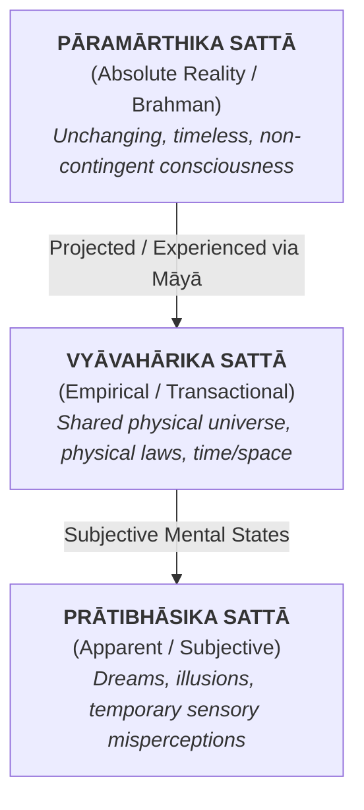

# Sattā

## The Indian Philosophical Framework of Reality

In Western philosophy, the study of existence—ontology—often wrestles with a binary question: does something exist, or does it not? Classical Indian philosophy, particularly within the traditions of **Advaita Vedānta**, **Sāṁkhya**, and **Nyāya**, approaches existence through a far more nuanced framework. Rather than treating existence as an all-or-nothing property, classical thinkers developed the concept of **Sattā** (सत्ता)—the ontological nature of "Being," "Reality," or "Existence."

Derived from the Sanskrit root _sat_ (सत्, "that which is"), _Sattā_ is not merely an abstract noun for existence. It is a systematic taxonomy used to analyze how human cognition perceives, categorizes, and experiences different orders of truth.

## The Three Levels of Reality (Sattā-traidha) in Advaita Vedānta

The most influential formulation of _Sattā_ comes from Shankara’s Advaita Vedānta, which categorizes reality into a three-tiered hierarchy (_Sattā-traidha_). This model solves a key epistemological problem: how can something be experienced directly by the mind without being ultimately real?

### 1. Prātibhāsika Sattā (Apparent or Subjective Reality)

_Prātibhāsika Sattā_ refers to super-subjective reality—experiences that exist solely within the mind or perception of a single observer and vanish upon closer inspection or waking up.

- **Examples:** Dreams, halluncinations, or mistaking a rope for a snake in low light.

- **Ontological Status:** It possesses temporary subjective reality. As long as you are dreaming, the fear or joy you feel is real; it has causal efficacy (_arthakriyākāritva_) within that specific psychological state. However, it is negated (_bādhita_) the moment you wake up.

### 2. Vyāvahārika Sattā (Empirical or Transactional Reality)

_Vyāvahārika Sattā_ is the objective, physical world shared across observers. It is the realm of science, daily life, ethics, cause-and-effect, and empirical observation.

- **Examples:** The physical universe, biological bodies, social structures, trees, mountains, and time.
- **Ontological Status:** Unlike _Prātibhāsika Sattā_, empirical reality is consistent across multiple observers and abides by natural laws over time. It cannot be negated by ordinary human perception. However, Vedānta posits that it is still contingent and mutable—it is real relative to our embodied human consciousness, but ultimately ephemeral when evaluated against absolute timelessness.

### 3. Pāramārthika Sattā (Absolute Reality)

_Pāramārthika Sattā_ is the non-contingent, eternal, and unchangeable baseline of existence—**Brahman** (Pure Consciousness).

- **Definition:** That which persists across all three divisions of time (past, present, future) without undergoing modification (_parināma_) or sublation (_bādha_).
- **Ontological Status:** While the physical world and dream states constantly change and pass away, _Pāramārthika Sattā_ is the ultimate ground upon which both subjective and empirical experiences are projected.

## Sattā in Nyāya and Sāṁkhya Realism

While Vedānta treats empirical reality as ultimately relative, rival classical schools offer distinct metaphysical interpretations of _Sattā_:

- **Nyāya-Vaiśeṣika (Epistemological Realism):** The logicians of Nyāya treat _Sattā_ as the highest universal (_Mahā-sāmānya_)—a distinct, real property possessed by physical substances (_dravya_), qualities (_guṇa_), and actions (_karma_). For Nyāya, the physical world is not an illusion or a lower level of reality; it is fully real and independently exists outside human perception.
- **Sāṁkhya (Dualistic Realism):** Sāṁkhya grounds reality in two uncreated, ultimate principles: **Prakṛti** (primordial, evolving matter) and **Puruṣa** (pure consciousness). Here, _Sattā_ applies equally to both, but in different forms: _Prakṛti_ possesses changing, dynamic reality (_parināmi-sat_), while _Puruṣa_ possesses unchangeable, static reality (_aparināmi-sat_).

## Modern Cognitive Parallels: Predictive Processing & Neural Construction

What makes the Indian framework of _Sattā_ remarkably enduring is its close structural alignment with modern cognitive psychology and neuroscience:

1. **User Interface / Predictive Processing:** Modern cognitive scientists like Donald Hoffman (_Interface Theory of Perception_) and Anil Seth (_Predictive Processing_) argue that human sensory perception does not register "objective reality as it truly is." Instead, the brain generates a highly constrained, utility-based perceptual model—strikingly similar to **Vyāvahārika Sattā**.
2. **Controlled Hallucination:** Neuroscientific models suggest that waking perception is essentially a "controlled hallucination" constrained by sensory input, while dreams (_Prātibhāsika Sattā_) are uncontrolled hallucinations where incoming sensory feedback is cut off.

## Summary of Realities

|**Level of Reality**|**Sanskrit Term**|**Domain**|**Epistemological Criterion**|**Modern Parallel**|
|---|---|---|---|---|
|**Apparent**|_Prātibhāsika_|Dreams, illusions, hallucinations|Sublated upon waking/correct perception|Subjective mental simulation|
|**Empirical**|_Vyāvahārika_|Physical universe, body, consensus world|Persists through life; governed by physical laws|User interface / Evolutionary consensus perceptual model|
|**Absolute**|_Pāramārthika_|Pure Consciousness (_Brahman_)|Unchangeable across past, present, and future|The ultimate ground of subjective awareness|